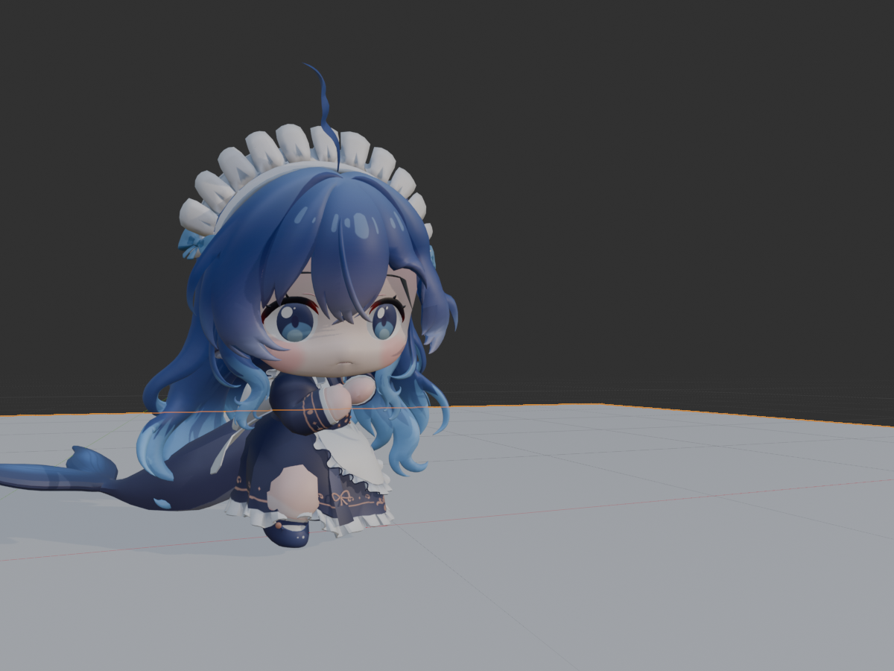
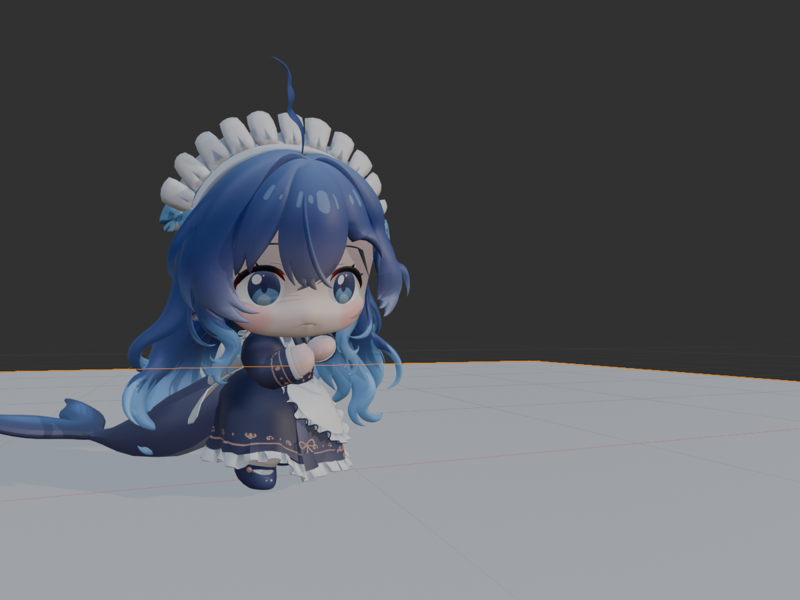

# 动态骨骼裙面与 FBX 修订复核

2026-10-25补充复核：下面记录的是当时过滤范围与0.25帧网格的历史结果。扩大几何范围、细化到0.125帧后发现漏检；不得把历史“零交叉”用作完整裙面无穿模证明。根因、纠正与新的定量证据见[后续审计](../2026-10-25-spring-bone-foot-audit/result.md)。

状态：用户已确认“符合预期，可以收尾”。76 个临时诊断文件已按路径、大小和 SHA256 核对后清理，清理后测试、真实场景及最终 FBX 复验通过。本次修订已收尾；下列性能与原有回归问题继续保留。

## 当前结果

- 当前动作：`骨架_a050_302010.002_Spring_SkirtContact`，原动作保留。
- 保留原静态裙长、骨架 Rest、原有权重和八条四节链；没有 Shrinkwrap、隐藏身体或新增变形骨。
- Blender 5.1.2 真实场景经 BlenderMCP 复核 0–52 帧、步长 0.25，共 209 点，腿/脚与裙面三角形交叉为 0。
- 实际完整角色 FBX 已导出并回导，209 点交叉为 0，最大蒙皮误差 0.0000014246 米，约 0.001425 mm。
- FBX 回导起点比源 Action 多 1 帧；按片段相对时间对齐后比较，时长和运动保持。
- 原动作摘要不变，原始网格/权重指纹不变；修复四元数符号后，53 个整帧的身体蒙皮位移差为 0 米。

[最终完整角色 FBX](character-skin-contact.fbx) · [真实场景复核](live-review.json) · [真实 FBX 回导](fine-range/live-fbx-result.json) · [整帧姿势等价](key-pose-equivalence.json)

## 确认的根因与修复

1. 旧求解只检测尾点，无法保证骨骼之间的裙面不穿插；腿部胶囊也没有包住真实蒙皮。新增可选裙面后处理，使用身体实际网格，包含碰撞骨的脚部后代。
2. 胶囊端帽错误地去除了碰撞法线的轴向分量，推开后仍有残余。已在原 `solver.collision_direction` 修复，端帽用真实球面法线。
3. 来源动作有相邻四元数键反号。`upper_leg.L` 在第 7.5 帧长度从 0.084788 修复到 0.993698；不是靠改变整帧腿姿来掩盖。结果副本修复 367 个符号键，原动作不动；Retarget 未来写键也保持同半球。
4. 真实 Blender 调用 AppData 中的旧 Retarget，而非工作区。旧导出只产生 53 个采样键，丢失中间修正。已只补通用 `fbx_sample_step` 与四元数写键接缝，实际最终 FBX 为 209 个采样键。
5. 自身模态操作的 RNA 标识可能为大写 `SPRING_BONE_OT_*`。已统一标识，避免把自身误判为“其他操作”；外部变换操作仍被拒绝。

## 实现与原设计偏差

- 初版尾点物理仍按原公式、缩放及骨长硬门执行。新增 `SkirtContactBakeJob` 是已有动作的后处理，不放宽原物理生成限制。
- 初版只写模拟骨旋转；新后处理允许有上限的链首三维 location 修正。上限相对本次输入 Action，多次修正可累积；本模型复用半帧结果补到四分之一帧。
- 非模拟曲线原本要求数值完全复制。现仅在结果副本中修复错误四元数符号和跨半球插值；关键帧旋转姿势等价，原 Action 不变。修复路径和数量保存在动作元数据。
- 普通 FBX 通过通用 Action 元数据接入；两个插件仍不互相 import。没有改映射、IK、绑定或既有片段选择职责。
- 实测 Blender 5.1.2 与 5.2.1，最低声明同步为 5.1.2。5.0/4.2 兼容未验证。

见 [设计修订](../../specs/2026-10-23-spring-bone-design.md#10-2026-10-24-裙面与-fbx-修订)、[实施档](../../plans/2026-10-24-spring-bone-skin-contact.md)、[Goal Prompt](../../plans/2026-10-24-spring-bone-skin-contact-goal.md)。Goal Prompt 按文件实际 CRLF 文本计数 1573 字符，小于 2800。

## Retarget 与安装副本边界

仓库仅改 `retarget._bake_retarget` 的同半球写键，以及 `pipeline._export_fbx_with_rest_bind/_export_current_selection` 的采样参数。其他 A-Pose、挂点和安装 BAT 的在途修改保留。

实际安装路径为 `C:/Users/chenshajie1/AppData/Roaming/Blender Foundation/Blender/5.1/scripts/addons/humanoid_retarget/`。安装副本含独有 ContactGoal 流程，未整文件覆盖；只在其对应写键/导出位置补同一修复，保留预采样等原流程。两文件原字节备份和前后哈希见 [部署记录](installed-patch.json)。Spring Bone 当前从工作区加载。

## 验证分层

| 层级 | 本次结果 |
| --- | --- |
| Static | Passed：AST、精确范围 diff、无新增代码注释、单向依赖；无 bpy 工作线程 |
| Contract/Process | Spring Bone：5.2.1 为 86，5.1.2 为 86，均退出 0；实际安装副本定向 19 项通过 |
| 聚焦 RED/GREEN | 端帽残余、三角形内部穿插、反号四元数、FBX 丢失半帧、Retarget 跨半球写键、自身模态标识均取得失败后修复；错误过滤器的 selected=0 不计通过 |
| A-Pose 回归 | 23 项通过；仅回归已有路径，不声称密集采样 A-Pose 重烘焙已验收 |
| Retarget 总回归 | 同一“the final hop removes horizontal root travel”失败；在内存撤去本次四元数修复后仍复现，属当前基础已有问题。见两份回归日志 |
| Runtime | Passed：真实场景 209 点；源动作、Rest、权重、四节链保持；工作副本/未交付结果失败时清理 |
| FBX | Passed：当前场景完整角色真实文件回导，最大误差约 0.001425 mm，209 点交叉为 0 |
| Visual | 已亲看第31帧前后图：原腿部穿出消除，脚/鞋自然外露符合保留原裙长；用户于 2026-10-24 确认画面符合预期 |
| UI 模态交互 | invoke 返回 RUNNING_MODAL，但当前非活动窗口未推进 WM 事件；未把它算完整交互通过。已停止并确认原动作、帧与计时器/会话恢复；同步执行和生命周期测试已通过 |
| 性能 | 第26帧困难样本实测，见下文；生成阶段不是实时求解 |
| Build/Generated/C++ | NotApplicable：Python/Markdown，无 C++ 文件、工具链、unique_ptr、ABI 或格式专项门 |
| RealTransport/Apply/Resim | NotApplicable：本任务没有引擎网络/回滚目标 |
| 本次修订验收 | Passed：用户画面确认、76 项精确清理和清理后复验完成；不包含上述尚未验证或已有失败的独立目标 |

主要证据：[Spring 5.2](spring-regression.log)、[Spring 5.1](spring-blender-5_1.log)、[四元数写键](quaternion-contract.log)、[A-Pose](apose-regression.log)、[安装副本](installed-checks.log)、[Retarget 本次](retarget-regression.log)、[撤去修复的基线](retarget-baseline.log)、[原生 invoke 记录](live-modal.json)。

## 性能与生命周期

owner 为 `SkirtContactBakeJob`。Scene/Armature/Mesh 为借用；工作 Action 与未交付结果由作业拥有，成功移交结果、删除工作副本。取消、异常、删除目标、切换 Action/Slot/模式/NLA、编辑曲线/权重以及帧率/单位变化均有针对性验证。计时器保留创建时 WindowManager，失效计时器可重复清理。

性能优化未放宽验证：Action/网格指纹改为批量读取和二进制哈希，仍检查关键帧/控制柄、拓扑和权重。困难第26帧单元最长从约 499 ms 降到 208.0 ms；P95 约 58.1 ms，单帧修正约 11.6 秒。Concern：生成阶段仍超过 16 ms 的交互软目标，后续可继续优化；没有宣称实时网格模拟。完成后是原生 Action 播放，无新增每帧物理 handler 或诊断轮询。

## 适用边界与收尾

当前表面交叉检测不保证共面接触、完全包围体、任意连续时间或布料自碰撞。结论限定于声明的 0.25 帧采样、身体腿/脚区域和普通动画 FBX。原 Spring 生成对 NLA、非均匀缩放等限制保持，不能把已有动作后处理通过宣称为所有输入均能重新物理生成。

[临时诊断清单](temporary-diagnostics.json) 共 76 个精确文件，含哈希。生产模块未加入临时日志、轮询或统计开关。正式测试、最终 FBX、必要输入/输出与验证证据保留。用户于 2026-10-24 确认画面。已删除全部 76 个匹配文件，共 102171093 字节，无缺失项、哈希冲突或递归删除。清理清单中的文件现存数量为 0，未修改生产代码。

清理后复验：Blender 5.1.2 与 5.2.1 各 86 项通过，四元数写键 1 项、A-Pose 23 项通过，进程均退出 0。BlenderMCP 当前场景及最终完整角色 FBX 再次各检查 209 点，交叉为 0；FBX 最大蒙皮误差仍约 0.001425 mm。当前动作、八条四节链、原动作和用户帧/选择保留；无活动作业或临时工作 Action。测试生成的两份既有 lifecycle fixture 已恢复原字节。

证据：[清理记录](cleanup-result.json)、[清理后场景](post-cleanup-live.json)、[5.1 测试](post-cleanup-spring-5_1.log)、[5.2 测试](post-cleanup-spring-5_2.log)、[四元数](post-cleanup-quaternion.log)、[A-Pose](post-cleanup-apose.log)、[FBX](post-cleanup-fbx.log)。

没有自动暂存、提交或推送；没有撤销其他任务的修改。
